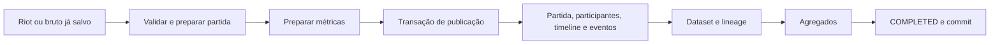

# Validação da arquitetura de processamento de partidas

**Ainda há ganhos importantes em código e no modelo de persistência. Não estamos no ponto de concluir que só resta adicionar workers.** Nas duas rodadas principais, a implementação atual processou 0,96–1,04 partida/s; a escrita em lote com SQL parametrizado, mantendo o schema, chegou a 1,81–1,94; e um dataset relacional normalizado chegou a 2,16–2,26. Todos usaram o mesmo coordenador em TypeScript e PostgreSQL, sem trocar NestJS.

Minha recomendação é manter o monólito modular e a publicação atômica, reduzir o trabalho do ORM nos inserts volumosos e desenvolver o modelo normalizado como candidato a schema definitivo do dataset. A adoção desse modelo depende de resolver o contrato numérico e avaliar suas consultas seletivas. O desenho com métricas compactadas em JSONB economizou mais espaço, mas transferiu custo para a leitura; separar a publicação em consumidores não foi superior neste experimento.

Isso é uma recomendação sustentada pelas alternativas implementadas, não uma prova de ótimo global. Não foram comparadas implementações completas em Go, Rust ou outra linguagem, nem drivers diretos, COPY ou um banco analítico. Também não foi demonstrada a saturação da máquina inteira.

Estudo do commit `413628a821370b39628ecb234cb3bc6490d0254e`, realizado em 7–8 de outubro de 2026. Complementa a [auditoria inicial](../processing-performance-audit.md), substituindo sua fixture única por um corpus variado e acrescentando alternativas de modelagem, escala, recuperação e leitura. Os protótipos estão em [scripts/architecture-study](../../../scripts/architecture-study/README.md). Nenhum adapter, migration ou configuração de produção foi alterado.

## Arquitetura atual e garantias que precisam permanecer

O projeto é um monólito modular com processos de API, collector e worker. NestJS compõe os módulos; PostgreSQL/Prisma armazena jobs, brutos, projeções e agregados; RabbitMQ entrega trabalho; Redis participa da coordenação e dos limites da Riot. O banco é relacional, apesar do nome do repositório.

O [ProcessingService](../../../src/modules/processing/services/processing.service.ts) faz claim com lease, renova a posse e a revalida dentro da publicação. Projeções, dataset, agregados e conclusão ficam na mesma transação. O gate de manutenção é compartilhado entre processamentos normais; o rebuild usa exclusão. O bruto é preservado para recuperação e reconstrução. Essas propriedades têm valor: acelerar a gravação sem mantê-las pode produzir resultados parciais ou contados duas vezes.

Os limites de módulos e portas permitiram trocar os adapters experimentais sem reescrever domínio, cálculos ou coordenador. Isso já responde parte da questão arquitetural: a organização atual permite uma persistência especializada. Não é necessário escolher entre manter todo o caminho atual e reescrever toda a aplicação.

## Método, corpus e alcance

Foram coletados **120 pares reais de summary/timeline**, em 253 chamadas, com arquivos comprimidos e SHA-256 preservados no [manifesto](corpus-manifest.json). A coleta usa históricos de jogadores obtidos a partir da liga Challenger BR, com seleção determinística de sementes. É uma amostra de conveniência, não uma amostra representativa de toda a população.

| Característica | Corpus coletado |
| --- | --- |
| Filas | 96 partidas solo/duo 420; 24 flex 440 |
| Mapa | 120 partidas no mapa 11 |
| Patches | 16.19: 80; 16.18: 18; 16.20: 10; 16.9: 7; 16.8: 5 |
| Brutos comprimidos | 8.617.595 bytes |
| Coorte aceita pelo código atual | 119 partidas |
| Eventos da coorte medida | 131.203 |
| Contribuições históricas da coorte medida | 104.363, ou 877 por partida |

Uma partida foi rejeitada pelo preparador atual. A exclusão foi explícita e o arquivo original não foi corrigido para fazer o teste passar. O diagnóstico está na seção de correção abaixo. Comparar os protótipos com o código atual verifica preservação de comportamento; não valida independentemente o significado científico das métricas em cada patch.

O timer inclui enqueue/claim, leitura dos brutos no banco, descompressão, parsing, cálculos, writers e commit. Em D, inclui também a publicação posterior das métricas e dos agregados. Exclui download, espera por quota da Riot, RabbitMQ, compressão inicial para salvar o bruto e bootstrap completo do Nest. Portanto, os números medem processamento com bruto disponível, não a ingestão online completa.

O ambiente usou Node 26.10.0, Prisma 6.16.3 e PostgreSQL 15, com durabilidade ligada: `fsync`, `synchronous_commit` e `full_page_writes`. O banco experimental ficou limitado a 2 CPUs, 2 GiB e `shared_buffers=256MB`, em dois núcleos E, afinidade 4,5. Os processos Node das rodadas principais usaram dois núcleos P distintos, afinidade 0,2, com três conexões por processo. Ver [ambiente](environment.json) e configuração registrada nas rodadas.

A primeira rodada usou os irmãos SMT 0,1 e é exploratória. Seus valores absolutos não foram agrupados com as rodadas principais. A estação tem i5-1245U, 12 CPUs lógicas e aproximadamente 15 GiB; reservar parte desses recursos não equivale a usar toda a máquina. Frequências, cache, carga externa e ordem dos ensaios ainda introduzem variabilidade.

As rodadas 2 e 3 inverteram a ordem das variantes. São duas repetições completas, não dezenas de amostras independentes de capacidade. Os intervalos apresentados são mínimos e máximos observados; não são intervalos estatísticos de confiança. Os percentis descrevem este corpus finito.

## Alternativas implementadas

| Variante | Alteração | Transação e disponibilidade |
| --- | --- | --- |
| A | Código atual | Publicação atômica atual |
| B | Eventos via recordset SQL; retorno reduzido do INSERT da timeline | Mesma transação |
| B2 | B + dataset via recordset + incrementos agrupados em aproximadamente três UPSERTs | Mesma transação, mesmo schema |
| C | Metadados por partida; dimensões por sujeito/horizonte; métricas agrupadas em JSONB | Mesma transação; view expõe o contrato anterior |
| D | Layout C; job durável para publicar métricas e depois agregados | Três estágios; término medido depois de todos |
| E | Metadados por partida; dimensões por sujeito/horizonte; valores das métricas em colunas tipadas | Mesma transação; view expõe o contrato anterior |

B2 não é simplesmente “usar bulk insert”: o projeto já usa `createMany`. O protótipo troca milhares de campos serializados pelo protocolo do ORM por payloads parametrizados que o PostgreSQL expande em linhas. Mantém Prisma como coordenador da transação. Os agregados consolidam chaves repetidas antes do UPSERT e preservam incrementos, distribuição de posições e última partida. O PostgreSQL fornece as [funções JSON de conversão em registros](https://www.postgresql.org/docs/15/functions-json.html); os parâmetros são enviados pela [API de SQL do Prisma 6](https://www.prisma.io/docs/orm/v6/prisma-client/using-raw-sql/raw-queries).

Em E, os 877 valores continuam existindo. A mudança evita repetir, em cada valor, metadados comuns à partida e às dimensões. Há chave estrangeira do valor para o grupo, chave natural única por grupo/definição/versão e índice de definição. Não houve remoção de métricas para melhorar o benchmark. Uma futura implementação deve declarar o schema e colunas explicitamente, em vez de depender da introspecção DMMF usada pela bancada.

D separa **publicação**, não todo o cálculo: o primeiro estágio ainda prepara o dataset. Ele persiste o payload e os deltas; consumidores posteriores aplicam métricas e agregados. O consumidor de agregados permite até dez jobs por transação, mas os lotes observados foram de um job. Não há espera deliberada para formar lote. O resultado não elimina outras estratégias de processamento assíncrono, cálculo independente, materialização sob demanda ou separação OLTP/OLAP.

Os consumidores posteriores de D ainda carregam os módulos da bancada e fazem aquecimento do caminho completo. Seu RSS medido não é o mínimo possível de serviços especializados apenas nesses estágios. O maior custo de memória observado é uma característica deste protótipo, não uma prova de custo mínimo obrigatório de toda arquitetura assíncrona.

## Capacidade, custo de CPU, WAL e armazenamento

Rodadas principais: 119 partidas, dois processos, uma partida por processo, mesma divisão de recursos.

| Variante | Rodada 2, partidas/s | Rodada 3, partidas/s | CPU Node por partida, ms | CPU PostgreSQL por partida, ms | Relações e índices, MB |
| --- | ---: | ---: | ---: | ---: | ---: |
| A | 0,963 | 1,038 | 1.331–1.391 | 577–704 | 298,0–298,4 |
| B | 1,311 | 1,347 | 886–925 | 572–589 | 298,0–298,2 |
| B2 | 1,813 | 1,936 | 466–510 | 582–591 | 300,9–301,2 |
| C | 2,106 | 2,217 | 465–500 | 407–427 | 174,3 |
| D | 2,078 | 2,011 | 606–642 | 563–581 | 200,1–204,0 |
| E | 2,262 | 2,158 | 430–469 | 416–436 | 252,6–252,9 |

Fontes: [rodada 2](round-2-w2.json) e [rodada 3](round-3-w2.json). MB são decimais. O armazenamento soma relações e índices, incluindo brutos e tabelas auxiliares; não é só o dataset nem o tamanho de backup. Aquecimento com rollback pode deixar espaço físico e WAL. CPU PostgreSQL vem do container, e CPU Node soma os processos medidos; os dois custos não devem ser confundidos.

Comparando dentro de cada rodada:

- B aumentou a capacidade em aproximadamente 30–36% sobre A, com dataset mantido no writer atual.
- B2 aumentou a capacidade em aproximadamente 86–88% sobre A, mantendo o schema. É a maior parte do ganho obtido sem remodelar dados.
- E aumentou a capacidade em aproximadamente 108–135% sobre A. Seu ganho adicional sobre B2 foi de **11–25%**, não um ganho garantido de 30%.
- C reduziu o armazenamento total em aproximadamente 42% frente a B2; E, aproximadamente 16%. A vantagem de espaço de C veio acompanhada de regressões importantes em leitura.
- D não superou C de forma consistente. Acrescentou CPU, memória e um contrato de disponibilidade mais complexo.

O WAL observado ficou em aproximadamente 370–375 MB em A, 371–381 MB em B2, 198–200 MB em C e 294–295 MB em E. Assim, B2 diminui muito trabalho no cliente sem reduzir proporcionalmente o volume persistido; C e E também diminuem esse volume. O delta de WAL é do cluster dedicado e pode incluir atividade residual de aquecimento/background; não representa uma medição de IOPS nem permite declarar o SSD saturado.

Há uma distinção importante entre throughput e custo: E gasta menos CPU PostgreSQL por partida que B2, mas ambos ainda podem se beneficiar de mais trabalho em voo. A melhora não veio de desligar durabilidade ou omitir a conclusão dos estágios.

## Processos e concorrência dentro do worker

O ensaio de escala usa as mesmas 60 partidas em cada configuração. A divisão total de CPUs permanece fixa; aumentar processos não aumenta o orçamento do banco.

| Configuração | A, partidas/s | B2, partidas/s | E, partidas/s | Soma dos picos RSS de E |
| --- | ---: | ---: | ---: | ---: |
| 1 processo × 1 partida | 0,553 | 1,053 | 1,152 | 370 MiB |
| 2 processos × 1 partida | 1,014 | 1,891 | 2,149 | 713 MiB |
| 4 processos × 1 partida | 1,292 | 2,447 | 2,777 | 1.303 MiB |
| 2 processos × 2 partidas | 1,306 | 2,450 | 2,879 | 794 MiB |

Fontes: [um processo](scale-w1.json), [dois](scale-w2.json), [quatro](scale-w4.json), [dois com duas partidas simultâneas](scale-w2-slots2.json). RSS é a soma dos picos individuais amostrados, não o pico simultâneo exato nem memória incremental atribuível a uma linha de código.

Neste ensaio, dois processos com duas partidas simultâneas entregaram capacidade próxima à de quatro processos, com menor soma de picos RSS. Isso justifica testar concorrência limitada por worker. Não justifica aumentar prefetch sem limite: a bancada chama o serviço diretamente, enquanto a adoção real precisa preservar renovação de leases, backpressure, shutdown e comportamento do consumidor RabbitMQ.

A [comparação dos dados entre essas duas configurações](scale-validation.json) passou para A, B2 e E, nas sessenta partidas: projeções e dataset armazenados foram exatamente iguais dentro de cada variante. Os agregados mantiveram conteúdo não numérico e contagens, com as pequenas diferenças de soma em ponto flutuante registradas separadamente. Essa comparação verifica concorrência entre configurações; não elimina a diferença numérica entre o writer original e os writers bulk.

Com duas partidas por processo, A consumiu em média aproximadamente 1,83 dos dois núcleos Node disponíveis; B2, 1,29; E, 1,40. No PostgreSQL, foram aproximadamente 0,87, 1,54 e 1,29 núcleos, respectivamente. Esses números mostram que o perfil do limite muda após otimizar a escrita. Não identificam sozinhos espera de lock, I/O ou contenção interna; tampouco demonstram esgotamento do hardware completo.

O pool deve ser orçado por processo e por papel. Mais conexões não tornam uma única transação paralela: operações na mesma conexão continuam serializadas, inclusive dentro de `Promise.all`, como documentado pelo [Prisma 6](https://www.prisma.io/docs/orm/v6/prisma-client/queries/transactions). O paralelismo útil deste teste é entre partidas.

## Chegada contínua e tamanho da fila

As partidas foram programadas em intervalos fixos, independentemente da velocidade do consumidor, com distribuição circular entre dois processos. O relógio começa na chegada programada e termina quando todos os resultados estão disponíveis. Assim, a latência inclui espera; não mede somente o tempo dentro do serviço.

| Chegadas | Variante | Conclusão média | p95 de conclusão | Máximo de partidas pendentes ou em processamento |
| --- | --- | ---: | ---: | ---: |
| 1/s | A | 1,82 s | 2,24 s | 3 |
| 1/s | E | 0,83 s | 1,08 s | 2 |
| 1/s | D | 1,09 s | 1,36 s | 2 |
| 2/s | A | 25,10 s | 46,55 s | 55 |
| 2/s | E | 1,07 s | 2,13 s | 5 |
| 2/s | D | 1,46 s | 2,30 s | 5 |

Fontes: [chegada de uma partida/s](arrival-1.json) e [duas/s](arrival-2.json). Os máximos de trabalho pendente vêm de amostras a cada segundo; incluem partidas em execução. São 119 chegadas em cada caso, e não um teste de estabilidade por horas. O throughput de E e D fica limitado pela oferta nesses ensaios; perto de duas partidas/s aqui não significa teto de capacidade.

Na segunda carga, A terminou aproximadamente 1,10 partida/s e acumulou espera. E acompanhou melhor a oferta; D também drenou o trabalho, mas exigiu consumidores adicionais. Em D, o atraso médio entre publicação dos fatos e disponibilidade completa foi de aproximadamente 354 ms a uma chegada/s e 428 ms a duas/s. Marcar apenas os fatos como prontos esconderia esse atraso.

## Consultas: otimizar a escrita pode transferir custo à leitura

O teste usa o `DatasetQueryRepository` real: retorna vinte linhas e o resumo da coorte inteira. Limitar a página a vinte linhas não limita o trabalho das agregações.

| Filtro, 119 partidas | A atual | C compacto JSONB | E normalizado |
| --- | ---: | ---: | ---: |
| Fila 420, patch 16.19 | 11.700 ms | 22.177 ms | 12.525 ms |
| Campeão 80, posição UTILITY, elegíveis | 37 ms | 1.794 ms | 157 ms |
| Uma definição e horizonte final | 89 ms | 5.933 ms | 282 ms |
| Um jogador | 703 ms | 137 ms | 109 ms |

Fonte: [experimentos de leitura](read-experiments.json), primeira execução de cada filtro. Esses valores não são p95 de produção e há efeitos de cache e ordem. Ainda assim, a magnitude das regressões seletivas impede recomendar C somente por throughput e espaço. E também não domina A em todos os filtros: joins e distribuição dos índices têm custo, embora a consulta por jogador tenha melhorado.

A consulta atual conta jogadores distintos em uma subconsulta correlacionada por grupo. O primeiro protótipo de leitura calcula essas contagens uma vez por chave e faz join com os agregados. Mantém o contrato e não introduz materialização assíncrona. Na coorte ampla, a mediana de três repetições caiu para aproximadamente **3.122 ms em A**, **13.849 ms em C** e **4.665 ms em E**. Não houve diferenças não numéricas nas respostas comparadas; pequenas diferenças de soma em ponto flutuante seguem o cuidado já descrito.

Esse resultado prova uma oportunidade relevante em SQL de leitura mesmo sem remodelar o dataset. Também mostra por que apenas comprimir o dataset em JSONB é insuficiente: decodificação e expansão continuam caras. A escolha de layout deve considerar os filtros e a frequência de consultas do produto, além de gravação e armazenamento. A documentação de [CTEs no PostgreSQL 15](https://www.postgresql.org/docs/15/queries-with.html) explica como materialização e uso repetido afetam a avaliação; os planos medidos são necessários para decidir cada reescrita.

Outra hipótese localizada é alinhar o predicado de jogador ao índice: o SQL atual usa `puuid = ANY(playerIds)`, enquanto os layouts experimentais criam GIN sobre o array. Uma forma a avaliar é contenção com `playerIds @> ARRAY[puuid]`, preservando a semântica de filtro e os parâmetros. `@>` faz parte dos [operadores indexáveis de arrays no GIN](https://www.postgresql.org/docs/15/gin-builtin-opclasses.html). Essa reescrita não foi medida; a existência do índice, sozinha, não comprova que o plano o aproveita.

Há também uma decisão de contrato da API: hoje cada página recalcula o resumo integral. Separar paginação e resumo, ou reutilizar um resumo vinculado a uma versão/snapshot, pode evitar trabalho repetido. Isso exige definir frescor e consistência entre contagens e linhas; não foi implementado na bancada. Mover análises amplas para uma projeção própria pode ser apropriado no futuro, mas os resultados atuais justificam primeiro corrigir o SQL e medir o padrão real de acesso.

### O que os planos revelaram

O [ensaio de planos](query-plans.json) executa `ANALYZE` e compara a reescrita de jogadores com duas formas de CTE: `SELECT *` e somente as colunas necessárias aos resumos. Em E, na coorte ampla de 119 partidas, a resposta completa caiu de 4,56–4,81 segundos para 3,06–3,09 segundos. As respostas desse comparativo foram exatamente iguais, sem diferenças numéricas. É uma segunda melhoria de SQL, além de eliminar a subconsulta correlacionada.

O plano do resumo por grupo mostra a largura estimada da CTE cair de 1.249 para 322 bytes por linha. Os blocos temporários lidos no nó raiz caíram de 11.947 para 4.602; ainda houve ordenações externas. Isso sustenta a explicação de que materializar colunas volumosas que o resumo não utiliza acrescenta custo. Os números do nó raiz já incluem seus descendentes; não se devem somar todos os nós como se fossem custos independentes. A documentação de [EXPLAIN](https://www.postgresql.org/docs/15/using-explain.html) orienta essa leitura.

Também houve estimativa de cardinalidade ruim em E: a CTE foi estimada em 877 linhas, mas produziu 66.652. Na tabela de metadados, estimou-se uma partida onde havia 76 no filtro. O protótipo ainda extrai `datasetVersion` e `processingVersion` de JSON; numa implementação definitiva, esses filtros merecem colunas tipadas e estatísticas adequadas. A divergência de estimativa foi medida; o ganho de uma nova alteração de schema/estatísticas não foi medido.

Em A, limitar as colunas levou a resposta de 3,09–3,49 segundos para 2,75–2,78 segundos. Em C, de 12,89–14,24 para 11,83–11,94 segundos: a melhoria não eliminou o custo do layout compacto. Todas as respostas desse ensaio de planos permaneceram exatamente iguais dentro de cada variante.

Desligar JIT localmente não trouxe benefício relevante em E, cujos planos não registraram compilação JIT. Em A, houve aproximadamente 76–80 ms de compilação; desligá-la com a projeção reduzida produziu 2,63–2,69 segundos. É um efeito pequeno diante das alterações de SQL, com apenas duas repetições por configuração. Não há evidência para recomendar desativação global. O PostgreSQL decide JIT com base no custo estimado e sua disponibilidade no servidor; ele também pode adicionar overhead, como explica a [documentação de JIT](https://www.postgresql.org/docs/15/jit-decision.html). Esses planos retornam à coorte menor; não representam uma repetição das consultas de 655 partidas com todas as otimizações.

## Gravação sobre histórico existente

Foi criado um histórico de 595 partidas por layout: as 119 partidas aceitas mais quatro cópias com novos IDs. Depois foram processadas sessenta partidas adicionais, também com IDs distintos, terminando com 655 partidas. Jogadores, campeões, patches e datas são deliberadamente reutilizados. É um ensaio de volume e concentração, não uma ampliação da diversidade do corpus.

| Variante | Novas partidas/s sobre histórico de 595 |
| --- | ---: |
| A | 1,086 |
| B2 | 1,994 |
| C | 2,220 |
| E | 2,167 |

Fontes: [construção do histórico](history.json) e [gravação sobre histórico](history-writes.json). As alternativas mantiveram vantagem sobre A nesse volume. E ficou aproximadamente 8,7% acima de B2 nesta rodada, reforçando que sua vantagem adicional é menor e mais variável que a grande melhoria obtida ao substituir os inserts volumosos do ORM. C ficou ligeiramente acima de E em escrita, mas a escolha depende também de leitura e contrato.

O experimento não demonstra capacidade em milhões de partidas. Os índices, a distribuição de jogadores e as estatísticas do planner ainda correspondem a uma base pequena e concentrada. Também não houve leitores concorrendo com os writers durante a medição.

As [leituras com 655 partidas](history-reads.json) reforçam o cuidado com o crescimento. A consulta ampla original falhou nos quatro layouts sob os limites da bancada: 20 segundos por statement e 30 segundos por transação. Tempo até erro não foi contado como resposta bem-sucedida.

| Variante | Resumo amplo após reescrever a contagem de jogadores | Campeão/posição, mesma reescrita | Uma definição, mesma reescrita | Um jogador, mesma reescrita |
| --- | ---: | ---: | ---: | ---: |
| A | 26.252 ms | 56 ms | 320 ms | 2.659 ms |
| B2 | 20.780 ms | 47 ms | 309 ms | 2.613 ms |
| C | Falhou por timeout | 12.799 ms | Falhou por timeout | 11.937 ms |
| E | 27.836 ms | 929 ms | 1.525 ms | 1.076 ms |

Valores são medianas das três tentativas com a reescrita, quando concluídas. No resumo amplo, o original falhou e por isso não houve comparação direta da resposta antiga com a nova nessa base. A igualdade do contrato da reescrita foi verificada na coorte menor e nos filtros que responderam. O ganho de escrita de E não elimina a necessidade de otimizar seus leitores; C teve regressões de leitura ainda maiores neste volume.

## Correção e fidelidade numérica

Foram comparados nove conjuntos de projeções e agregados, todas as contribuições da coorte, consultas reais e uma exportação delimitada. Timestamps operacionais e IDs substitutos de times/estatísticas foram excluídos da igualdade lógica; IDs determinísticos do dataset foram preservados. Ver [validação B/B2/C/D](corpus-validation.json) e [validação E](normalized-validation.json).

As projeções de partida, times, participantes, timeline e eventos foram logicamente iguais. A variante B também preservou exatamente o dataset, inclusive na comparação da representação armazenada obtida diretamente pelo PostgreSQL.

A bancada conserva o caminho real de leitura de lineage, mas não cria observações de descoberta para o corpus de replay: ele exercita a marcação de origem desconhecida. Não demonstra todos os casos de múltiplas observações, ranks e descobertas simultâneas. Esses cenários precisam permanecer nos testes da implementação final.

**B2, C, D e E não passaram em igualdade numérica estrita do dataset.** Houve 819 caminhos numéricos diferentes na leitura pelo Prisma, com diferença absoluta máxima de `5,33 × 10⁻¹⁵`. Ao comparar a representação do PostgreSQL via `row_to_json(... )::text`, apareceram 10.318 caminhos diferentes, com máximo absoluto de `3,64 × 10⁻¹²` e relativo de `5,32 × 10⁻¹⁶`. Por exemplo, um valor armazenado como `11` no caminho atual ficou `11.000000000000002` no protótipo.

Isso não significa 10.318 partidas ou necessariamente 10.318 linhas: são caminhos de campos. Não houve diferenças estruturais ou não numéricas nesse dataset. Os cálculos de domínio foram mantidos; a conversão de persistência produz representações ligeiramente diferentes. A leitura comum do ORM pode esconder parte dessas diferenças, por isso a segunda comparação é necessária.

A tolerância usada pelos scripts é somente diagnóstica. Não aprova uma mudança silenciosa de contrato. Antes de adotar o bulk do dataset ou outro layout, é preciso escolher entre preservar os valores atuais de forma reproduzível ou versionar explicitamente a representação e reconstruir o dataset. Não recomendo arredondar resultados apenas para tornar o teste verde.

Também ocorreram diferenças pequenas nas somas dos agregados, inclusive em B, que conserva o writer de estatísticas. A ordem de adição de floats entre partidas concorrentes pode variar. Esse fenômeno precisa ser separado da conversão do dataset; não se deve atribuir toda diferença ao novo adapter. Contagens inteiras e conteúdo não numérico permaneceram iguais nos casos comparados.

Na exportação de uma partida, `features.jsonl`, `labels.jsonl` e `descriptive.jsonl` foram idênticos em bytes. Metadados incluem timestamps operacionais e, nos caminhos bulk, pequenas diferenças numéricas. A exportação delimitada não prova igualdade byte a byte de um export completo das 119 partidas ou de todos os possíveis splits.

### Rejeição indevida por ordem dos participantes

Na partida `BR1_3283642155`, a ordem de PUUIDs em `timeline.metadata.participants` corresponde aos IDs `[3,2,4,5,1,8,7,9,6,10]`. Já os pares explícitos de `timeline.info.participants` concordam com o summary, e os conjuntos de PUUIDs são iguais. O [preparador](../../../src/modules/matches/adapters/riot/match-preparer.ts) assume identidade pela posição no array; o [parser](../../../src/modules/matches/adapters/riot/match.parser.ts) também usa essa associação.

Reordenar apenas os metadados em memória, a partir dos pares explícitos, fez a preparação passar com 733 eventos e 877 contribuições. O [diagnóstico](corpus-rejection.json) foi preservado; os arquivos brutos continuam intactos. A correção indicada é construir o mapa por `participantId`/`puuid`, validar unicidade e consistência com o summary, e tratar metadados como conjunto. Esse problema merece correção independentemente da escolha de arquitetura.

**Correção posterior, em 13/10/2026:** o preparador agora usa os pares explícitos do summary, valida os pares da timeline quando presentes e trata os metadados como conjunto. Identidades duplicadas, contraditórias e frames com IDs desconhecidos continuam sendo rejeitados. A [comparação do corpus completo](../participant-identity-validation.json) aceitou as 120 partidas e confirmou igualdade dos resultados preparados, incluindo o dataset, para as 119 anteriormente aceitas. A partida antes rejeitada publicou 733 eventos e 877 contribuições em banco isolado, com retry de `FAILED`, redelivery e duas reconstruções sem duplicação; seus gzip originais foram preservados. O diagnóstico e os benchmarks anteriores permanecem como registros dos respectivos códigos e populações.

O retry de um job já marcado como `FAILED` é explícito: `npm run processing -- retry BR1_3283642155`, no ambiente correspondente após atualizar o código. A correção não altera automaticamente bancos da aplicação nem modifica versões de processamento, pois os resultados das partidas anteriormente aceitas foram preservados.

## Recuperação, duplicidade e reconstrução

Os [sete testes de falha de D](failures.json) passaram: rollback da publicação inicial, entrega duplicada, entrega fora de ordem, `SIGKILL` durante escrita de métricas, consumidores concorrentes, `SIGKILL` depois dos incrementos e repetição após commit. Foram processos realmente encerrados por sinal, com verificação de rollback e ausência de dupla contagem. Não foi exercitado o ack do broker nesses testes.

O [rebuild](rebuild.json) executou o coordenador real em A, B2, C e E, com cinco partidas reais: interrupção após duas, retomada das três restantes e nova reconstrução completa. O estado lógico armazenado permaneceu igual dentro de cada variante. O mecanismo continua **offline**, como exige o serviço atual. Não houve demonstração de troca de gerações com API online.

A [transição controlada de versão](version-transition.json) também passou em A, B2, C e E. Em cópias isoladas dos bancos de cinco partidas, a versão de processamento mudou de 4 para 5 e a definição `snapshot.xp` foi retirada do materializador. As 4.385 linhas antigas deram lugar a 4.145 linhas, sem sobras da versão anterior ou da definição retirada. O leitor da versão 4 ocultou a geração nova; o leitor configurado para 5 a publicou. As constantes foram alteradas somente na memória do processo de teste. Isso verifica a mecânica de substituição offline, não uma nova fórmula, migration de produção ou atualização online sem indisponibilidade.

D tem trabalho adicional antes de adoção: readiness das rotas, limpeza/cancelamento dos jobs em rebuild, versionamento dos estágios e correção de partidas já agregadas. Sua tabela experimental de jobs não tem o mesmo encadeamento de exclusão por FK das projeções. Os testes de recuperação de uma geração não cobrem esse ciclo completo.

C e E são protótipos de publicação de partidas novas e rebuild completo. Ainda não substituem todas as semânticas de remoção/regravação isolada que o adapter atual pode oferecer. Uma migração de produção precisa tratar esses caminhos explicitamente, junto com chaves, índices e compatibilidade dos leitores.

## NestJS, TypeScript e alternativas de linguagem

Nest não aparece como causa demonstrada do custo por partida neste estudo. Os ganhos maiores foram obtidos mantendo o serviço e os cálculos TypeScript, alterando a forma de gravar e representar os dados. Trocar Express por Fastify atua principalmente no servidor HTTP; não elimina serialização do Prisma, inserts, índices ou locks do worker.

Uma composição de worker com apenas os módulos necessários ainda faz sentido para reduzir dependências, memória de base e inicialização. A bancada não sobe o AppModule completo, portanto não quantifica esse ganho nem o inclui como melhoria por partida.

Go com pgx, Rust ou .NET com acesso eficiente ao PostgreSQL continuam alternativas possíveis. Nenhuma recebeu uma implementação equivalente nesta validação; não há base para afirmar qual processaria esta carga mais rápido. Antes de uma reescrita, o próximo comparativo útil seria trocar somente o driver do adapter quente ou testar COPY, conservando domínio, SQL, recursos e garantias. Todas as escritas da publicação precisariam usar a mesma conexão/transação. A documentação do [node-postgres](https://node-postgres.com/features/transactions) explicita essa exigência, e a documentação do [PostgreSQL](https://www.postgresql.org/docs/15/populate.html) descreve o caminho de carga com COPY.

Há oportunidades de CPU no domínio identificadas na auditoria anterior: percursos repetidos de eventos por horizonte, construção duplicada de gráficos, conversões JSON e zlib síncrono. Não foram implementadas neste estudo. Seu ganho deve ser medido depois dos writers, porque a distribuição do custo mudou. Equivalência deve preservar missingness, ordenação de eventos, identidade e ausência de informação futura nas features.

Mesmo E não esgota a modelagem possível. Campos estáveis de definição, como unidade e uso, ainda aparecem nos valores; um catálogo imutável por definição/versão pode reduzir repetição adicional, ao custo de mais joins e cuidados com o histórico. Evidências JSON continuam necessárias para auditoria e não devem ser descartadas apenas por tamanho. Essa alternativa não foi implementada ou medida; é uma hipótese para depois de escolher os contratos e examinar o perfil restante.

Na rodada 2 de E, os dois maiores comandos registrados somaram aproximadamente 23,0 segundos de execução SQL para eventos e 12,4 segundos para o dataset, ao longo das 119 partidas. São tempos acumulados com sobreposição entre processos, não parcelas diretamente somáveis do tempo de parede. Eles indicam onde investigar em seguida: conversão dos payloads, largura das linhas e índices, além do driver. Acelerar só o framework não elimina esse trabalho.

## Critério para considerar mais workers a próxima melhor ação

“Não há nenhuma otimização possível” não é uma conclusão verificável por um conjunto finito de testes. O critério operacional útil é comparar ganho por recurso e custo de implementação, preservando os contratos do produto.

Depois da implementação candidata, repetir um teste prolongado com o bruto congelado, população e volume histórico maiores, API lendo simultaneamente e a composição real do consumidor. Medir partidas completamente disponíveis, idade da fila, p95/p99, CPU por partida, RSS/GC, duração e espera de transações, conexões, locks, WAL e I/O. `pg_stat_statements` ajuda a localizar o SQL custoso; suas métricas precisam ser interpretadas junto com o tempo de ponta a ponta, conforme a [documentação do PostgreSQL 15](https://www.postgresql.org/docs/15/pgstatstatements.html).

Adicionar um worker é uma boa próxima ação quando o orçamento de recursos permite, a fila precisa de mais capacidade, o teste demonstra ganho com mais processamento e as otimizações restantes têm retorno menor ou comprometem os contratos. Se o banco estiver saturado, replicar workers pode aumentar a espera; se o limite for a quota da Riot, mais consumidores não aumentam a taxa de aquisição. A capacidade de replay medida aqui não deve ser confundida com essa quota.

O resultado atual sustenta investir na persistência e nas consultas antes de uma troca de framework. Também sustenta testar concorrência limitada por processo. Não sustenta declarar que chegamos ao limite físico ou que a linguagem escolhida é irrelevante em qualquer escala.

## Decisão e sequência de implementação

| Decisão | Recomendação | Condição para adoção |
| --- | --- | --- |
| Nest/TypeScript | Manter enquanto a persistência é especializada | Reavaliar linguagem apenas com um comparativo equivalente que isole custo restante |
| Eventos e retorno da timeline, B | Primeiro candidato a incorporar | Testes de rollback, lease, redelivery e corpus no adapter definitivo |
| UPSERTs agrupados | Incorporar com ordenação e consolidação das chaves | Preservar contagens, posições, timestamps e comportamento concorrente |
| Bulk do dataset, B2 | Candidato forte de baixo impacto estrutural | Resolver representação numérica, versionamento e regravação |
| Dataset normalizado, E | Candidato preferido para evolução estrutural entre os layouts testados | Contrato numérico, semântica completa do writer e leituras seletivas aceitáveis |
| Dataset compacto JSONB, C | Não adotar como única fonte para as consultas atuais | Só reconsiderar com um caminho de leitura próprio e benefício comprovado |
| Publicação em três estágios, D | Não adotar agora apenas para throughput | Necessidade de negócio para consistência eventual, readiness e rebuild completos |
| Duas partidas por processo | Testar na composição real do worker | Limite explícito, pool orçado, memória e leases sob carga |
| Resumo do dataset | Reescrever SQL independentemente do layout escolhido | Igualdade do contrato, plano e latência medidos nos filtros relevantes |

Como o projeto ainda está em desenvolvimento, faz sentido definir agora as fronteiras do dado: bruto imutável para replay; projeções operacionais; contribuições versionadas; e agregados derivados. A recomendação estrutural é reduzir repetição e especializar adapters nessas fronteiras, mantendo o commit atômico enquanto ele atende à carga. O experimento não encontrou necessidade de criar novos serviços para obter a maior parte do ganho.

Eu faria a implementação em mudanças revisáveis: primeiro corrigir a identidade dos participantes; depois eventos e agregados; em seguida decidir o contrato numérico e o schema definitivo do dataset junto com as consultas. Concorrência vem depois da nova linha de base. Cada etapa deve repetir o mesmo corpus e as garantias de recuperação para que o ganho e eventuais regressões tenham causa identificável.

Antes de integrar E, faltam especificamente: migration oficial com timestamp real; constraints e índices revisados; limpeza/regravação por partida; versões e definições retiradas; filtros e export completos; testes de lease expirada e falhas no adapter final; e carga prolongada com leitura e escrita concorrentes. A bancada experimental não é uma migration pronta nem uma alteração automaticamente aprovada para produção.

## Entrega e verificações finais

As doze etapas do [executor principal](execution.json), a [transição de versão e os planos](followup-execution.json) e a [verificação de concorrência](scale-validation-execution.json) terminaram com código zero. Isso não transforma os timeouts de leitura ou as diferenças numéricas registradas em testes aprovados de adoção: são resultados analisados nas respectivas seções.

A [verificação dos artefatos](artifact-verification.json) confirmou sintaxe dos scripts, JSONs legíveis, os 240 hashes dos arquivos de corpus, links locais e ausência de token Riot nos artefatos do estudo. O commit e os arquivos rastreados da aplicação permaneceram iguais. A aplicação compilada foi usada na bancada; a suíte completa de testes unitários/integrados com broker não foi executada nesta etapa. Os testes aqui descritos são os específicos dos protótipos, coordenadores e dados preservados.

Os dados brutos permanecem localmente em `.tmp/architecture-study-corpus`, ignorados pelo Git. Os resultados e scripts podem ser revisados sem a chave da Riot. O [README da bancada](../../../scripts/architecture-study/README.md) contém comandos, isolamento e reprodução; o [resumo numérico](summary.json) deriva dos resultados registrados. Os bancos experimentais foram preservados para inspeção. As tabelas deste relatório distinguem os ganhos medidos das hipóteses que ainda exigem um novo experimento.

Ao encerrar o estudo, o container `highbr-architecture-study-pg` foi parado, sem apagar seus bancos. Não restaram containers em execução. Para inspecioná-los novamente, use o comando de inicialização do README.
