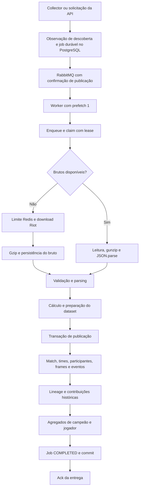

# Auditoria de desempenho do processamento de partidas

> Continuação: a [validação da arquitetura com corpus real e alternativas de persistência](architecture-study/report.md), de 7–8 de outubro de 2026, amplia este diagnóstico. As medições abaixo são preservadas como a etapa inicial, com uma fixture; use o estudo posterior para avaliar as alternativas estruturais.

**Conclusão: ainda existem otimizações relevantes antes de tratar mais workers como a principal solução.** A maior oportunidade medida está no caminho de escrita das projeções e do dataset pelo Prisma. No cenário sequencial, essas duas etapas ocuparam 86% do tempo; parsing e preparação do dataset, 5,6%. Um protótipo restrito a eventos e retorno da timeline reduziu em 35,9% o tempo dos writers, com equivalência exata na fixture. O banco, a cota da Riot e os registros de agregação compartilhados continuam sendo limites independentes: saturar a CPU de um worker não demonstra que a máquina inteira, ou a arquitetura, chegou ao melhor aproveitamento possível.

Auditoria do commit `413628a821370b39628ecb234cb3bc6490d0254e`, concluída em 6 de outubro de 2026. O escopo é investigação e relatório. Os scripts adicionados são instrumentos de auditoria; não alteram os adapters da aplicação. Foram usadas as migrations existentes em um banco exclusivo, sem criar ou renumerar migrations.

## Arquitetura atual e caminho crítico

O projeto é um **monólito modular com processos de API, collector e worker**, escrito em TypeScript/NestJS, com PostgreSQL/Prisma para persistência, RabbitMQ para entrega e Redis para coordenação e limites da Riot. Apesar do nome do repositório, a persistência analisada é relacional. Os módulos têm contratos e portas explícitos; regras e cálculos puros de partidas são separados de adapters. A composição permite testar o processamento sem subir HTTP ou depender da Riot. Ver [ADR de fronteiras](../architecture/ADR-001-modular-boundaries.md), [composição de processamento](../../src/composition/processing.ts) e [schema](../../prisma/schema.prisma).



O fluxo em [ProcessingService](../../src/modules/processing/services/processing.service.ts), principalmente `processMatch`, `publish`, `claim` e `lockLease`, preserva propriedades importantes:

- O PostgreSQL é a fonte de verdade do job; a fila pode reenviar mensagens.
- A lease tem token, expiração de 120 segundos e renovação a cada 20 segundos. O claim condiciona a transição de estado; a publicação valida a posse com `FOR UPDATE`.
- O bruto é preservado antes da publicação das projeções. Uma falha na timeline permite aproveitar o summary já salvo.
- Parsing e preparação das contribuições acontecem antes da transação principal.
- Projeções, dataset, agregados e `COMPLETED` são publicados na mesma transação. O ack ocorre após o tratamento durável; uma falha registrada como retry pode ser confirmada na fila sem significar sucesso da partida.
- O advisory lock de manutenção é **compartilhado** no processamento normal. Ele não é um mutex global que serializa todas as partidas; o rebuild usa o lado exclusivo desse gate.
- A atualização de estatísticas ordena chaves antes dos incrementos para reduzir deadlocks.

Essas garantias são uma boa base. A otimização deve encurtar o caminho crítico preservando atomicidade, idempotência, lineage e distinções entre ausência, zero, SQL NULL e JSON null. Os testes existentes em [processing.integration-spec.ts](../../test/integration/processing.integration-spec.ts) cobrem concorrência, redelivery, rollback, lease expirada e rebuild; serão essenciais para implementar qualquer proposta.

Nem todo calculator do repositório roda na ingestão. A materialização do dataset chama famílias específicas, como combate, objetivos, sequências, visão e contribuição, além das métricas por horizonte. Diversas análises são calculadas nas consultas. Otimizar um calculator fora desse caminho não acelera automaticamente o worker.

## O que foi medido

O [benchmark de processamento](processing-performance-benchmark.json) executou o código compilado do commit consolidado, em PostgreSQL 15.19 local, Prisma 6.16.3 e Node 26.10.0. A máquina tem i5-1245U, 12 CPUs lógicas e aproximadamente 15,4 GiB de RAM. O banco mantém `fsync`, `full_page_writes` e `synchronous_commit` ligados. Não se desabilitou durabilidade para melhorar resultados.

O corpus contém **uma partida real**, copiada com outros IDs: 1.966 eventos e 877 contribuições históricas por partida. Houve duas partidas de aquecimento e oito medições por cenário, totalizando 34 partidas. Summary/timeline comprimidos foram inseridos antes da medição. O ensaio inclui enqueue, claim, leitura/descompressão, cálculos, publicação e commit; exclui descoberta, download, limite Redis, RabbitMQ, gravação inicial do bruto e bootstrap completo do Nest.

| Etapa no cenário sequencial | Média por partida | Parcela do total |
| --- | ---: | ---: |
| Validar e preparar partida/timeline | 40,2 ms | 2,1% |
| Preparar contribuições do dataset | 68,4 ms | 3,5% |
| Gravar projeções de partida | 1.124,8 ms | 58,0% |
| Gravar dataset | 543,8 ms | 28,0% |
| Atualizar agregados | 102,4 ms | 5,3% |
| Controle, leitura dos brutos e demais custos | 60,7 ms | 3,1% |
| **Total** | **1.940,3 ms** | **100%** |

A última parcela é o resíduo do total, não uma medição independente. O timer `publish` contém preparação do dataset e writers; não deve ser somado a eles. As consultas contabilizadas pelo evento do Prisma somaram aproximadamente 415 ms por partida, contra 1.940 ms de ponta a ponta. Esse evento não é um profiler de CPU do PostgreSQL: tem arredondamento em milissegundos e não representa todo o trabalho de serialização, preparação e agendamento no cliente. A diferença motivou os experimentos de escrita, sem atribuí-la integralmente a uma única causa.

| Concorrência em um processo Node | Jogadores | Partidas/s | Latência média | CPU do processo em equivalentes de núcleo | RSS ao final |
| --- | --- | ---: | ---: | ---: | ---: |
| 1 | Compartilhados | 0,515 | 1,94 s | 0,91 | 442 MiB |
| 2 | Compartilhados | 0,645 | 3,01 s | 1,60 | 564 MiB |
| 4 | Compartilhados | 1,001 | 3,64 s | 2,74 | 774 MiB |
| 4 | Distintos | 1,064 | 3,50 s | 2,78 | 840 MiB |

CPU acima de um núcleo é possível: a medição inclui threads nativas do processo, como o engine Prisma, além do JavaScript. Ela não inclui o PostgreSQL. No último cenário, os campeões continuam compartilhados; mudar PUUIDs não elimina a contenção de `champion_stats`. RSS é uma fotografia de um processo reutilizado entre cenários, não pico nem custo incremental causal de cada nível de concorrência. A ordem fixa e o pequeno corpus também impedem atribuir a diferença entre os dois cenários de concorrência quatro apenas aos jogadores.

Há espaço para sobrepor operações, mas quatro chamadas concorrentes produziram aproximadamente 1,94 vez o throughput sequencial, com maior latência e consumo de recursos. **Isso não justifica configurar prefetch quatro indiscriminadamente**, sobretudo porque o Compose declara apenas 1 CPU e 1 GiB por worker. O experimento usou recursos do host sem esses limites.

O [resumo do perfil de CPU](processing-cpu-profile-summary.json) mostra trabalho significativo no runtime JavaScript do Prisma, incluindo `nestArgument`, além de zlib e cálculos da aplicação. Esse perfil abrange inicialização, seeds e microbenchmarks; não serve para calcular a participação de gzip na ingestão medida nem para atribuir CPU às threads Rust. A categoria V8 `idle` também não significa que toda a máquina estava ociosa.

Essas medições são exploratórias. Com oito amostras, o p95 é o maior valor observado; não há um p95/p99 de produção confiável. Não houve corpus variado, banco com milhões de partidas, ensaio prolongado, isolamento de CPU, captura de IOPS/WAL ou carga simultânea representativa de leitura da API. O benchmark histórico de três cópias em [ARQ14](../architecture/evidence/arq14/benchmark.json) já indicava aproximadamente 0,503 partida/s, mas não é uma comparação controlada entre versões.

### Escala com processos independentes

O [ensaio de workers](processing-worker-scaling.json) usou um, dois e quatro processos Node independentes, cada um com seu cliente/pool Prisma e uma partida de cada vez. Foram oito partidas medidas por cenário, mais uma de aquecimento por processo. Todas terminaram como `COMPLETED`. O fluxo medido inclui claim e commit, com brutos previamente disponíveis. Os processos chamam a composição de processamento diretamente; não há transporte RabbitMQ, bootstrap completo do AppModule ou limite Redis nessa medição.

| Processos | Partidas/s | Ganho sobre um processo | Eficiência relativa à escala linear | Latência média por partida | Soma de RSS ao final |
| --- | ---: | ---: | ---: | ---: | ---: |
| 1 | 0,345 | 1,00 vez | 100% | 2,90 s | 513 MiB |
| 2 | 0,579 | 1,68 vez | 84% | 3,44 s | 953 MiB |
| 4 | 1,027 | 2,98 vezes | 74% | 3,70 s | 1.525 MiB |

Adicionar processos já aumenta a capacidade do código atual. O crescimento é sublinear e consome recursos adicionais; isso não prova qual recurso explica a diferença. Os quatro processos usaram juntos aproximadamente 2,85 núcleos de CPU em média, fora o PostgreSQL. A estação compartilhada estava sob carga maior nessa execução: load average inicial de 9,47/10,15/8,71. Portanto, não comparar os 0,345 partida/s diretamente com os 0,515 do primeiro ensaio nem concluir que quatro processos são equivalentes a prefetch quatro pelo acaso de ambos terem ficado perto de uma partida/s.

O resultado não determina o número ótimo de réplicas de produção. Os processos estavam sem a quota de 1 CPU/1 GiB, o corpus era uma cópia dos mesmos jogadores/campeões e cada processo no cenário de quatro recebeu somente duas partidas medidas. O RSS menor por processo nesse cenário pode refletir menos trabalho/acumulação do allocator; não é evidência de melhor eficiência de memória por réplica. A saturação física precisa de ensaio estável maior e telemetria do host/banco.

## ORM e gravação das projeções

### Experimentos comparativos e limites de equivalência

O [experimento de escrita](processing-write-experiments.json) comparou os mesmos adapters, dados preparados, timestamp, tabelas e índices. Cada variante teve um aquecimento e seis amostras, alternando a ordem entre rodadas. O timer cobre os três writers, incluindo agregados, mas exclui preparação, lease, leitura de bruto, commit, verificação e rollback. Todas as transações foram revertidas. O baseline desse ensaio é próprio: **não comparar seus 2,57 segundos diretamente aos 1,94 segundos do benchmark anterior**, executado em outro momento e com instrumentação diferente.

| Variante | Tempo médio dos writers | CPU média do processo | Redução de tempo frente ao baseline do ensaio | Equivalência exata na fixture |
| --- | ---: | ---: | ---: | --- |
| Atual | 2.570 ms | 1.928 ms | Referência | Sim |
| Lotes Prisma de até 250 linhas em eventos/dataset | 2.433 ms | 1.883 ms | 5,4% | Sim |
| Apenas `select: { matchId: true }` no retorno da timeline | 2.545 ms | 1.955 ms | 1,0% | Sim |
| Eventos via JSON recordset e retorno reduzido da timeline | **1.647 ms** | **1.101 ms** | **35,9%** | **Sim** |
| Eventos e dataset via JSON recordset, com retorno reduzido | 1.134 ms | 622 ms | 55,9% | **Não** |

Na quarta variante, o throughput inverso do tempo dos writers aumentou 1,56 vez e o custo de CPU caiu 42,9%. Só a operação de eventos caiu de aproximadamente 1.156 ms para 401 ms. Há evidência concreta de trabalho evitável no caminho de persistência atual, mesmo mantendo Prisma, Nest, schema, índices e a transação. O valor não é uma promessa de ganho de 56% na ingestão online nem uma aprovação para deploy: ainda falta corpus diversificado e testes completos da futura implementação.

Apenas reduzir o retorno da timeline baixou o tempo dessa operação de aproximadamente 284 para 234 ms, mas o total variou só 1%, com CPU total um pouco maior. Com a dispersão e a amostra pequena, não considero demonstrado um ganho relevante de ponta a ponta dessa mudança isolada. Lotes de 250 tiveram benefício total modesto e não aceleraram os eventos; não há suporte para tratar esse tamanho como ótimo universal.

**A quinta variante falhou na equivalência estrita do dataset.** Houve 93 diferenças em campos numéricos, incluindo valores aninhados, com diferença absoluta máxima de `3,64 × 10⁻¹²`. Por exemplo, o caminho atual persistiu `20.87859905344301` e o protótipo `20.878599053443008`. Não foram 93 partidas nem necessariamente 93 linhas: a contagem é de caminhos de campos divergentes. Os demais dados comparados, IDs determinísticos e flags de SQL NULL permaneceram iguais.

Essa diferença não foi arredondada nem ignorada para aprovar o experimento. É preciso definir a fidelidade numérica desejada e investigar a conversão atual antes de substituir a escrita do dataset; uma decisão de mudar os valores persistidos pode exigir versionamento/rebuild. O relatório preserva os tempos apenas como evidência de potencial, com `exactLogicalEquality: false` no JSON.

A validação compara conteúdo lógico das nove tabelas de projeções/agregados envolvidas, incluindo os campos das 877 contribuições e dos 1.966 eventos do ensaio. Desconsidera IDs substitutos autoincrementais e `lastUpdated`; compara separadamente IDs determinísticos e flags de SQL NULL. A comparação usa números/objetos JSON parseados, não igualdade de bytes do texto JSONB. O estado lógico anterior é verificado após os rollbacks. O teste não inclui fluxo completo de lease/RabbitMQ nem todas as variantes de dados que o domínio aceita.

### Prioridade maior é reduzir o custo das escritas volumosas

[MatchProjectionPersistenceAdapter](../../src/modules/matches/adapters/persistence/match-projection-writer.ts) já usa `createMany` para times, participantes e eventos. [DatasetPersistenceAdapter](../../src/modules/dataset/adapters/dataset-writer.adapter.ts) já divide as contribuições em lotes de 500. Portanto, recomendar apenas “usar bulk insert” seria insuficiente: o caminho atual já usa bulk, mas ainda paga conversões de objetos, serialização do protocolo do ORM e geração de SQL com muitos parâmetros.

Na fixture, uma chamada de `createMany` para eventos resultou em dois INSERTs reais; os dois lotes de dataset resultaram em dois INSERTs. O SQL de eventos somou aproximadamente 315 kB por partida e o do dataset, 227 kB, sem contar os valores dos parâmetros. A contagem real depende do engine e da largura das linhas; uma chamada do ORM não equivale necessariamente a uma instrução SQL.

Alternativas concretas são: reduzir o lote se houver benefício de memória/serialização; usar SQL parametrizado com `jsonb_populate_recordset` nos adapters volumosos; ou avaliar `COPY` em uma etapa posterior. O PostgreSQL fornece conversão de JSON para linhas tipadas e um caminho dedicado de carga com COPY. A integração precisa continuar usando a transação do coordenador: abrir outra conexão para copiar dados quebraria a publicação atômica. Ver [funções JSON do PostgreSQL 15](https://www.postgresql.org/docs/15/functions-json.html) e [carga de dados](https://www.postgresql.org/docs/15/populate.html).

O protótipo SQL mantém Prisma como gerenciador da transação. Não há evidência de que seja necessário substituir o ORM inteiro. Uma implementação final deve declarar colunas/tipos explicitamente, limitar o tamanho do payload e tratar evolução de schema, defaults, inteiros grandes, datas e nulos. O uso exploratório do tipo composto da tabela no script não é um adapter pronto para produção.

### Retorno de dados que o chamador descarta

`matchTimelineProjection.create` não usa `select` e seu resultado é descartado. O INSERT devolve o registro, incluindo `frames`, um JSON grande que acabou de sair do worker. Restringir o retorno a `matchId` evita esse transporte e conversão de volta. É uma mudança localizada, com menos risco que trocar a persistência inteira. Há retornos também descartados em outras escritas, mas a timeline é a candidata mais volumosa. A magnitude do ganho precisa vir do experimento específico, não do tamanho do objeto isoladamente.

### Agregados somam 50 comandos por partida

Em [PlayerStatsAggregationService](../../src/modules/stats/adapters/persistence/player-stats-writer.ts), dez participantes geram dez UPSERTs de campeão, vinte de jogador e vinte de jogador/campeão, para os escopos `ALL` e patch. O SQL já faz incrementos atômicos com `ON CONFLICT`; não há leitura seguida de escrita por participante. A oportunidade é agrupar incrementos por tabela/chave e aplicar poucos UPSERTs com múltiplas linhas.

O alvo é reduzir 50 comandos para aproximadamente três grupos, mas isso requer agregar chaves repetidas antes do INSERT, preservar `roleDistribution`, `GREATEST(lastPlayedAt)`, amostras válidas e ordem global de aquisição dos locks. Duas linhas com a mesma chave de conflito em um único INSERT precisam ser consolidadas. A solução não pode perder incrementos de partidas concorrentes.

No banco local essa etapa custou 102 ms. Mesmo removê-la completamente reduziria o total apenas em 5,3%, um teto teórico de aproximadamente 1,056 vez o throughput nesse cenário. Em banco remoto, 47 viagens sequenciais eliminadas poderiam poupar cerca de `47 × RTT` de espera adicional, sob a hipótese simplificada de custo constante por viagem. Após acelerar os inserts volumosos, os agregados podem passar a dominar.

Os registros de `champion_stats` são compartilhados por campeão/patch/fila e permanecem bloqueados até o commit. Partidas com jogadores diferentes ainda disputam campeões populares. Se essa disputa se tornar dominante após o batching, avaliar deltas imutáveis por partida e redução posterior, ou agregados particionados por bucket. Isso altera leitura, atualização e consistência; não é a primeira intervenção e não foi validado pelo ensaio atual.

### Transações e pool

`Promise.all` dentro da mesma transação interativa não transforma uma conexão em várias conexões paralelas. A documentação do [Prisma 6](https://www.prisma.io/docs/orm/v6/prisma-client/queries/transactions) confirma a execução serial nesse caso. Os ganhos devem vir de menos comandos, menos dados e menos trabalho dentro da transação; paralelismo é entre partidas, sob limite explícito.

A publicação configura `timeout: 30_000` e não configura `maxWait`; no Prisma 6 o padrão documentado de `maxWait` é dois segundos. Outras operações de controle usam cinco segundos. Sob concorrência alta, falta de conexão pode gerar retry antes de os 30 segundos de execução serem relevantes. Aumentar timeouts não é uma otimização de throughput: medir aquisição de conexão e duração de transação separadamente.

O [PrismaService](../../src/core/prisma/prisma.service.ts) compartilha um cliente por provider, uma prática adequada. O repositório não define `connection_limit` nas URLs do Compose. O engine Prisma 6 tem pool por instância e um padrão baseado em CPUs físicas; a capacidade deve ser orçada entre API, collector, workers e manutenção. Estabelecer limites explícitos por papel e reservar conexões operacionais antes de aumentar réplicas. Ver [pool do Prisma 6](https://www.prisma.io/docs/orm/v6/prisma-client/setup-and-configuration/databases-connections/connection-pool).

Há reduções menores de round trips: ler summary e timeline juntos quando ambos forem necessários; avaliar `UPDATE ... RETURNING` no claim, hoje seguido por `findUniqueOrThrow`; e evitar a atualização redundante de enqueue em entregas que já possuem job durável. A separação entre recuperação AMQP e chamada direta precisa continuar aceitando os casos suportados. A leitura repetida do gate não deve ser eliminada por cache sem preservar exclusão da manutenção. Esses custos são secundários no baseline, mas passam a importar após os inserts volumosos.

## TypeScript e CPU

O runtime executa JavaScript compilado em produção (`node dist/main`). Trocar compilador, tornar tipos mais estritos ou remover decorators não demonstra ganho de processamento. `ts-node` nos CLIs acrescenta custo de inicialização; para rebuild longo, o caminho compilado evita esse custo, mas não muda o trabalho de cada partida.

Há melhorias locais justificáveis em [TimelineParserService](../../src/modules/matches/adapters/riot/timeline-parser.service.ts): os quatro gráficos são alocados/preenchidos durante `extractTimeSeries` e depois substituídos pelos resultados de `legacyMinuteGraphs`. Essa segunda função percorre frames para cada participante e procura o PUUID nos objetos. Produzir os gráficos uma vez, com índices de participantes reutilizáveis, evita trabalho redundante. É necessário preservar `pathingSample`, ordem original, tratamento de timestamps e os zeros do contrato legado.

Em [dataset-builder.ts](../../src/modules/dataset/pure/dataset-builder.ts), cada um dos quatro horizontes reexamina eventos; dentro dele, definições e sujeitos repetem filtros por tipo e buscas de snapshot. Pode-se preparar índices por tipo, participante e time uma vez, percorrer prefixos temporais de forma incremental e pré-selecionar definições por uso/sujeito. A equivalência deve incluir eventos duplicados/conflitantes, campos ausentes, horizontes incompletos e a regra de não olhar o futuro. Como a preparação custou 68 ms, essa é uma prioridade posterior à persistência, sem promessa de multiplicar throughput.

As conversões recursivas de JSON das projeções ainda ocorrem dentro da transação; parte delas pode ir para uma fase `prepare` do writer. Também há clones `JSON.parse(JSON.stringify(...))` no dataset. Evitar cópias comprovadamente redundantes reduz alocação/GC, mas remover validação ou trocar por cast não preserva automaticamente o contrato de `undefined`, números não finitos e nulos. Uma otimização de cálculo deve passar pelos testes de corpus e de equivalência das projeções.

`gzipSync` e `gunzipSync` bloqueiam o event loop. Os microbenchmarks mediram gzip do summary em 3,9 ms, gzip da timeline em 62,3 ms e gunzip + parse da timeline em 24,8 ms, em média. Os dois gzip foram medidos sobre os arquivos originais em bytes, não sobre exatamente o mesmo buffer compacto de `saveRaw`, e não entram no ensaio com brutos pré-carregados. São indícios de custo, não parcelas a somar ao total.

Testar zlib assíncrono pode liberar o event loop durante compressão; JSON.parse/stringify continuam síncronos. As APIs assíncronas de zlib usam o pool interno do Node. Se o profile do caminho otimizado mostrar CPU JavaScript dominante, avaliar um pool limitado de `worker_threads` para preparação pura, contando transferência/clonagem e memória. Criar um thread por partida ou colocar I/O de banco em threads não resolve o problema observado. Ver [zlib](https://nodejs.org/download/release/v26.3.0/docs/api/zlib.html) e [worker threads](https://nodejs.org/api/worker_threads.html).

## Framework e composição dos processos

O worker inicia [AppModule](../../src/app.module.ts) inteiro com `NestFactory.create` e depois conecta o transporte RMQ em [main.ts](../../src/main.ts). Isso carrega módulos de consultas da API, controllers, collector, catálogos e configurações que o consumidor não precisa usar. Há efeitos de inicialização, como leitura de configuração do collector no Redis e carregamento local de `champions.json`.

Uma composição `WorkerAppModule` enxuta, iniciada como microservice, reduz dependências, memória de base e tempo de boot. Deve manter logging, shutdown, scheduler/dispatcher e providers necessários à ingestão. Como os providers atuais são normalmente singleton e o gargalo medido acontece nos writers, não atribuo um ganho por partida a essa separação sem medir.

Trocar Express por Fastify atinge o servidor HTTP; o processamento em discussão entra por RMQ. Retirar Nest, reescrever em outra linguagem ou migrar o ORM inteiro seriam intervenções maiores sem evidência proporcional. Primeiro otimizar os adapters volumosos usando as portas já existentes.

O [Dockerfile de produção](../../Dockerfile.prod) usa Node 20 e o benchmark local usa Node 26.10.0. Padronizar CI, imagem e benchmark em uma versão suportada é necessário antes de transferir conclusões para produção. Node 20 consta como EOL na [tabela oficial](https://nodejs.org/en/about/eol); a atualização deve ter validação própria e não ser vendida como ganho de performance já demonstrado.

## Coleta Riot, fila e capacidade de despacho

O limite implementado em [RateLimiterService](../../src/core/riot/rate-limiter.service.ts) é 100 requisições por 120 segundos por identificador de chave. Com duas chamadas para uma partida nova, o teto nominal é **25 partidas por minuto, ou 0,417 partida/s por chave**, antes de descoberta, retries e outras chamadas. É uma conta sobre a política do código, não uma garantia da Riot nem prova de que o limiter sempre conta corretamente. Com brutos já disponíveis, essa restrição não se aplica.

Collector e primeiro worker compartilham a variável de chave no [Compose](../../docker-compose.prod.yml). A mesma cota atende ambos. Mais consumidores usando a mesma chave não criam capacidade externa adicional. A Riot possui limites por aplicação, método e serviço; o planejamento deve respeitar os limites reais e headers recebidos, além de `Retry-After`, que a política atual já considera. Ver [documentação da Riot](https://developer.riotgames.com/docs/portal).

Há três fragilidades concretas no limiter e em [LockService](../../src/core/lock/lock.service.ts):

1. O lock fica retido enquanto `throttle` espera a janela liberar, inclusive durante os sleeps. Outros consumidores fazem tentativas repetidas de adquirir o mesmo lock.
2. O membro do sorted set é o timestamp em milissegundos. Duas admissões no mesmo milissegundo podem sobrescrever o mesmo membro e subcontar requisições; o uso atual de comandos separados não deve ser tomado como garantia de timestamps distintos.
3. O lock tem valor fixo, TTL de 130 segundos e liberação com `DEL` sem verificar proprietário. Se o TTL expirar e outro cliente adquirir, o antigo pode remover o novo lock. O loop de erro do Redis pode durar além desse TTL.

Um script Lua curto para podar/contar/admitir atomicamente, com membro único e retorno do próximo instante permitido, elimina a necessidade de segurar lock durante a espera. O atraso deve ocorrer fora da seção atômica. Esses pontos são deduzidos do código; não houve ensaio online contra Redis/Riot nesta auditoria.

Hoje download e processamento ocupam o mesmo slot de consumo. Para manter CPUs de processamento ocupadas durante throttling, avaliar separar aquisição do bruto e processamento de bruto pronto em estágios com estados duráveis distintos, backpressure e filas limitadas. Assim o número de downloaders segue a cota externa, enquanto os processadores seguem CPU/banco. Há custo arquitetural e de operação; para volume pequeno, a simplicidade do fluxo atual pode ser preferível.

Em [QueueService](../../src/core/queue/queue.service.ts), cada worker executa recovery a cada dez segundos, seleciona até 50 jobs e publica um por vez aguardando confirmação. `recovering` é local ao processo; workers diferentes podem selecionar os mesmos jobs. A lease evita duplicar a publicação lógica da partida, mas não elimina mensagens, enqueues e claims desnecessários. Os 50 por dez segundos representam cerca de cinco tentativas/s por processo apenas nesse caminho de recovery; não são um teto universal de toda a ingestão, que também publica imediatamente.

Com backlog grande, usar reserva durável para despacho em lotes, possivelmente com `FOR UPDATE SKIP LOCKED`, e publicação com concorrência limitada. A reserva precisa expirar e permitir reenvio após falha entre confirmação do broker e atualização de `publishedAt`; não se deve manter uma transação aberta aguardando RabbitMQ. Aumentar apenas o lote ou o número de schedulers pode multiplicar duplicatas.

`prefetchCount: 1` evita que um processo acumule entregas não confirmadas, mas também impede sobrepor partidas nesse consumidor. Depois de reduzir custo de escrita, tornar o valor configurável e medir 1/2/4 com o limite real de CPU/memória. Prefetch controla entregas em voo, não cria threads de CPU. Ver [RabbitMQ 3.13](https://www.rabbitmq.com/docs/3.13/consumer-prefetch).

## Banco, volume persistido e rebuild

Na medição inicial, `pg_total_relation_size` registrou 48,18 MB para eventos e 46,76 MB para contribuições de 34 partidas; aproximadamente 1,42 MB e 1,38 MB por partida, incluindo índices, TOAST e espaço alocado. Somando as tabelas da aplicação, o banco pequeno alocou aproximadamente 3,13 MB por partida, contra aproximadamente 100 kB de bruto gzip no benchmark histórico. São fotografias locais; não são coeficientes confiáveis para projetar disco de produção. O tamanho físico após ensaios com rollback também pode aumentar por tuplas mortas.

Eventos têm chave composta e dois índices adicionais; contribuições têm chave hash, identidade natural única e três índices adicionais. Há custo de manter ambos os modelos normalizados e suas evidências, mas eles sustentam consultas e reconstrução. Antes de remover um índice aparentemente redundante por prefixo, medir `pg_stat_user_indexes`, tamanho, custo das escritas e planos das consultas reais. A chave única do dataset e seu hash têm responsabilidades de integridade/identidade; removê-los por mera semelhança seria uma mudança de contrato.

As consultas de recovery filtram estado/data e ordenam prioridade decrescente/antiguidade. Os índices atuais ajudam filtros, mas não cobrem necessariamente a ordenação e todos os ramos do OR. Com população grande de jobs concluídos, medir `EXPLAIN (ANALYZE, BUFFERS)` em uma cópia representativa antes de escolher índices parciais e/ou separar ramos. Não há evidência suficiente no banco de 34 partidas para prescrever um índice novo específico.

Depois das otimizações de serialização, acompanhar WAL por partida, checkpoints, latência de fsync, utilização/fila do disco, buffers, tuplas mortas, autovacuum e espera por locks. Se armazenamento ou CPU do PostgreSQL estiverem saturados, novos workers podem piorar a fila; nesse caso a intervenção é no banco/layout/armazenamento. Não recomendo desligar fsync, usar tabelas unlogged para os dados duráveis ou remover a transação como atalho de benchmark.

O [RebuildService](../../src/modules/processing/services/rebuild.service.ts) processa lotes de 50 de forma sequencial, pausa ingestão, exige interromper a API conforme seu contrato e mantém uma transação de runner por até uma hora para o advisory lock. Essa transação ocupa uma conexão enquanto as transações por partida usam outras. Com pool de tamanho um, esse desenho não dispõe da segunda conexão necessária.

O timeout de uma hora é um limite de duração da execução, não da soma lógica das partidas reconstruíveis: um rebuild grande pode exigir retomadas. O custo do apagamento inicial em cascata também cresce com o histórico. Melhorias possíveis são processamento paralelo limitado sob o mesmo estado de manutenção, lock de sessão em conexão dedicada com cleanup robusto, ou uma lease durável de runner. Para reduzir indisponibilidade, gerações de projeções com troca atômica são uma evolução maior. O batch de 50 atual não representa 50 partidas concorrentes.

## Como decidir que chegou a hora de adicionar workers

O objetivo operacional deve distinguir três situações: um worker esgotou sua CPU enquanto há capacidade na máquina; a máquina de workers está esgotada; ou um recurso compartilhado/externalidade está no limite. Só na primeira um worker adicional na mesma máquina aproveita recursos livres. Na segunda, é preciso mais capacidade de hardware; na terceira, aumentar consumidores pode apenas criar espera.

Uma campanha de capacidade após as correções deve usar:

1. Corpus de partidas independentes, com tamanhos de timeline e durações variados; misturar jogadores/champions compartilhados e distintos.
2. Brutos prontos para medir processamento e um ensaio separado de aquisição online. Assim a cota Riot não mascara o limite local.
3. Mesma versão Node, imagem, limites de cgroup, rede e configuração de banco usados em produção. Medir também leituras concorrentes da API.
4. Ensaios de 1/2/4/8 processos e prefetch 1/2/4, um eixo por vez, com aquecimento, repetições e janela estável suficiente. Limitar memória e conexões explicitamente.
5. Throughput de **partidas únicas COMPLETED**, latência de fila e de processamento, falhas, retries, redeliveries, custo de CPU e bytes/WAL por partida. Entregas recebidas não são throughput útil.

| Observação | Interpretação e próxima ação |
| --- | --- |
| Worker perto da sua quota de CPU, banco com folga, pouca espera de pool/locks, outro núcleo disponível | Experimentar outra réplica; medir ganho marginal e custo por partida |
| Worker com CPU baixa, esperando Riot | Aumentar compute não resolve a cota; revisar separação aquisição/processamento |
| Event loop muito ocupado em preparação/serialização | Reduzir cópias/cálculos; processos ou threads limitados quando a CPU útil dominar |
| Muitas transações esperando agregados | Batching, menor duração de lock e eventualmente outra estratégia de agregação |
| Fila de conexões e falhas de `maxWait` | Ajustar orçamento global de pools e concorrência; avaliar saturação do banco |
| Banco no limite de CPU ou I/O/WAL | Otimizar persistência/layout ou ampliar o recurso compartilhado |
| RSS crescendo e GC frequente | Reduzir dados em voo/cópias e medir heap; aumentar prefetch pode piorar |
| Mais réplicas sem aumento de partidas únicas/s | Identificar o recurso serial/compartilhado antes de escalar novamente |

Uma regra de aceitação possível, a acordar como política operacional, é exigir aumento material do throughput por réplica sem regressão de p95/p99 de fila/API, taxa de erro, backlog de retry e custo por partida. Por exemplo, medir eficiência `T(2)/(2×T(1))` e `T(4)/(4×T(1))` ajuda a localizar a perda de escala; não existe um percentual universal que comprove limite de hardware. O estado atual ainda não atende a esse critério de maturidade.

## Instrumentação que deve acompanhar a implementação

O log `match_processing_completed.duration` começa depois do enqueue/claim. Ele não mede tempo na fila e não separa espera externa, CPU, pool e banco. Acrescentar histograms/timers para aquisição de lease, espera de rate limit, downloads, gzip/gunzip, parse, preparação de dataset, espera por conexão, cada writer e commit. Registrar tamanhos de payload, número de eventos/contribuições e versão de processamento para normalizar comparações.

Nos workers, coletar CPU por cgroup, throttling, RSS/heap/GC, utilização e atraso do event loop. No banco, coletar queries agregadas, espera de locks, conexões ativas/ociosas, WAL e I/O. Na fila, ready/unacked/redelivery, e no inbox, idade dos pendentes e proporção de claims que não obtêm trabalho. Evitar `matchId` como label de métricas de alta cardinalidade; mantê-lo em logs/traces.

## Ordem de execução proposta

| Prioridade | Trabalho | Evidência e critério de conclusão |
| --- | --- | --- |
| 1 | Instrumentar etapas e fixar baseline reproduzível | Distinguir CPU, ORM, banco, espera externa e fila; comparar o mesmo corpus |
| 1 | Reduzir retorno da timeline e otimizar inserção de eventos | Experimentos locais de persistência; exigir equivalência exata, rollback e rebuild |
| 1 | Avaliar dataset fora de `createMany` com contrato numérico explícito | Só adotar após resolver diferenças de precisão e nulos; não tratar protótipo como aprovado |
| 2 | Agrupar os 50 UPSERTs de agregados | Menos comandos com mesmos totais, distribuição de roles, datas e comportamento concorrente |
| 2 | Configurar pools, prefetch e composição mínima do worker | Demonstrar throughput por CPU/memória sob limites reais |
| 2 | Corrigir atomicidade e espera do rate limiter | Contagem correta por janela e concorrência, sem lock retido durante sleeps |
| 2 | Reservar despacho e limitar paralelismo de publicação | Menos duplicatas e recuperação após falha entre broker e inbox |
| 3 | Reutilizar índices/cálculos e reduzir cópias JSON/gzip síncrono | Profile do caminho otimizado e equivalência de corpus |
| 3 | Aumentar capacidade e duração do rebuild | Retomada, exclusão mútua e comparação integral dos resultados |
| Condicional | Separar aquisição/processamento, deltas de agregação, COPY, particionamento ou armazenamento frio | Somente quando métricas mostrarem o respectivo recurso como limitante |

Nenhuma porcentagem estimada deve ser somada às demais: uma melhoria muda a distribuição dos gargalos. A redução de eventos pode fazer dataset ou agregados virarem a próxima prioridade. O próximo passo tecnicamente mais justificado é uma mudança pequena nos adapters acompanhada das mesmas medições, preservando o modelo e as garantias transacionais.

## Evidências e reprodução

Os três instrumentos estão em [benchmark-processing-audit.cjs](../../scripts/benchmark-processing-audit.cjs), [benchmark-processing-writes.cjs](../../scripts/benchmark-processing-writes.cjs) e [benchmark-processing-workers.cjs](../../scripts/benchmark-processing-workers.cjs). Eles recusam bancos fora do padrão `highbr_processing_audit_*_integration`. O primeiro exige banco vazio e não apaga dados; o segundo reverte cada transação, embora sequências e espaço físico possam avançar; o terceiro adiciona IDs exclusivos. O banco local `highbr_processing_audit_20261005_integration` foi preservado para inspeção; nenhum banco de aplicação foi usado como alvo dos ensaios.

Em um PostgreSQL descartável criado para esse fim, definir `TEST_DATABASE_URL` para um banco com esse nome e executar:

```sh
npm run build
DATABASE_URL="$TEST_DATABASE_URL" node_modules/.bin/prisma migrate deploy
node --cpu-prof --cpu-prof-dir=/tmp scripts/benchmark-processing-audit.cjs /tmp/processing-baseline.json
node scripts/benchmark-processing-writes.cjs /tmp/processing-writes.json
node scripts/benchmark-processing-workers.cjs /tmp/processing-workers.json
```

Executar as medições sequencialmente para não fazê-las disputar recursos entre si. Os scripts leem a URL de `TEST_DATABASE_URL`, que deve estar exportada no ambiente. O profile bruto pode ser aberto no profiler V8/Chrome; o resumo versionado explicita seu escopo. O build do commit consolidado passou. As validações dos experimentos estão nos JSONs e no [registro de verificação da auditoria](processing-audit-validation.json), que também preserva as configurações observadas do PostgreSQL. A suíte completa da aplicação não foi reexecutada nesta auditoria porque nenhuma implementação de produção foi alterada.
